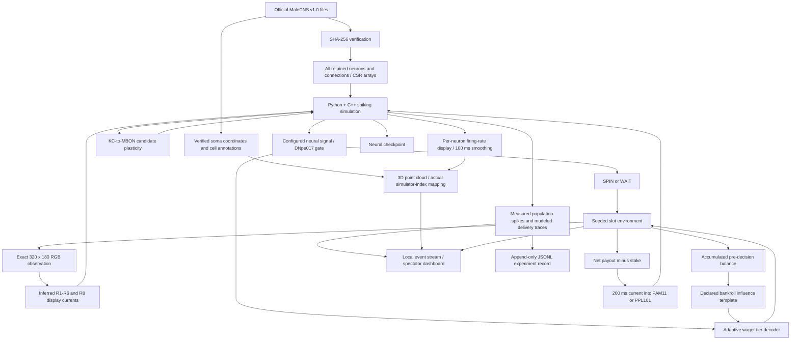

# Model and architecture

Flybet is a new local application and native simulator around the official MaleCNS v1.0 dataset. Stonkfly/DOOMFLY motivated its retention, display mapping, selected cell populations, and general experimental framing. It contains no trading broker, Coinbase SDK, LLM action policy, or substitute small network.

## Dataset and retention

The data are from the [MaleCNS project](https://male-cns.janelia.org/), associated with the [Google Research article](https://research.google/blog/a-connectomics-milestone-mapping-the-complete-male-fruit-fly-brain/) and [Cell paper](https://doi.org/10.1016/j.cell.2026.08.015). The release includes the male brain and ventral nerve cord.

`sources.lock.json` pins the official annotation, neurotransmitter and edge files by URL, byte size and SHA-256. Keep all entries with an assigned nonempty neuronal superclass, including uncertain classes; exclude explicit Glia and unresolved objects. Keep every released edge between retained endpoints, including weight-one edges and self-connections. Integer IDs never pass through floating point.

The official edge table includes other segmentation objects. In this build, 151,856,684 source rows contain 311,833,243 contact counts; retention produces **166,700 neurons, 25,582,938 directed edges, and 124,177,617 contacts**. This includes 10,299,701 weight-one connections and 101 self-connections. The upstream min-confidence 0.5 filtering remains part of the source release. "Full retained" does not mean every biological synapse is reconstructed.

The compiler emits NumPy arrays and a manifest. `graph.lock.json` independently commits their hashes. Runtime verifies the manifest against this lock and each array against its hash, then validates native shapes/indices. Dataset files remain separate from the repository and Nix closure.

## Electrical model

The values below describe the default template. Alternative physiology, chemistry, reward, vision and decoder assumptions, interventions, adaptive wagers and controlled learning protocols are specified in [experiments.md](experiments.md). All presets are uncalibrated hypotheses.

Each retained cell is represented by a single approximate leaky integrate-and-fire element. No morphology, receptor kinetics, muscles, body mechanics, graded photoreceptor physiology, or consciousness are reconstructed.

- Fixed timestep: 0.1 ms. Every neuron is integrated each step; there is no graph pruning.
- Membrane / synaptic time constants: 20 / 5 ms; resting voltage −52 mV, or −60 mV for Kenyon cells; threshold −45 mV.
- Spikes arrive after 1.8 ms and reset their source immediately. Refractory duration: 2.2 ms.
- Kenyon-cell spikes add an 8 mV adaptation term decaying over 200 ms.
- Baseline magnitude: contact count × 0.275. Acetylcholine is excitatory; GABA, glutamate and histamine inhibitory. Conflicting/unknown fast signs use a documented positive fallback. There are 3,718 uncertain-sign entries under this proxy.
- The 287 retained R8p/R8y → aMe12 edges use net excitation as an explicit transferred assumption; other endpoints remain unchanged.
- Pure dopamine, serotonin and octopamine annotations do not act as generic fast excitation. Selected PAM11/PPL101 edges deliver the traces described below. Other pure modulators have no modeled physiological effects. Anatomical retention does not establish that every edge's biological effect is modeled.

For a timestep h, the subthreshold update is the closed-form solution of a leaky membrane receiving a constant external drive, an exponentially decaying synaptic drive, and an exponentially decaying adaptation term. Tests compare the C++ integrator against an independent scalar implementation, including recurrent connections, self-connections, modulation, refractory periods, and subdivision across observation calls. These numerical checks do not validate the physiology against a fly.

## Display and decisions

The game renderer produces the exact RGB pixels displayed in the input panel. It includes current reels, a fake-credit bar, and phase text. It excludes the seed, scenario probabilities, future outcomes, and neural state. The spectator reels roll and stop successively over 1.05–1.57 wall-clock seconds when the committed spin count increases, landing on the exact recorded symbols. This finite outcome replay does not create additional neural frames or random outcomes, delay feedback, or animate WAITs. Reloading an existing result does not replay it. Reduced motion, a hidden tab, or a lost connection settles the display immediately.

3,335 R1–R6 cells sample linear-sRGB luminance. 811 R8p/R8y cells sample blue/green channel proxies. Modal contacts to column-annotated targets infer sampling positions; left/right viewports overlap. Unmapped photoreceptors receive no invented optical input. A 10 ms low-pass filter and a saturating current `30 L / (0.02 + L)` feed these cells; lamina cells receive a fixed 12-unit bias. These display choices strongly affect network activity and have not been calibrated to biological vision. The model does not automatically understand a symbol or read a credit number.

Each decision advances 300 ms of neural time using the pre-action image. The default interface chooses SPIN if mean DNp20 right-minus-left firing is at least 2 Hz and any DNpe017 cell fires. Otherwise it chooses WAIT. This is an engineered controller assignment, not an identification of natural betting neurons. A declared optional [bankroll influence](experiments.md#accumulated-bankroll) weights the neural margin for adaptive wager tiers using accumulated pre-decision funds. It leaves SPIN/WAIT, the gate and measured firing rates unchanged. The decoder receives no payout probabilities or future outcomes.

The explicitly labeled random baseline uses a separate seeded RNG to choose SPIN/WAIT at 50/50. The environment RNG is separate from policy choice. In both policies, the selected outcome is followed by 200 ms of outcome-image observation and reinforcement. WAIT has a neutral 200 ms phase. Wall time depends on computation and is not physiological time; pausing advances neither traces nor the neural clock.

## Reinforcement and candidate memory

Net result is payout minus the stake in integer cents. A positive result injects an artificial 20-unit current into all 15 annotated PAM11 cells for 200 ms. A negative result does the same to the two PPL101 cells. Zero net result supplies no external pulse. This describes binary reward with a sustained pulse and baseline chemistry. Other templates change encoding, timing and sensitivity; see [reward templates](experiments.md#reward-and-pulse-templates).

Actual network spikes, including endogenous dopamine activity, supply rates in 10 ms bins. The 7,835 existing KC → MBON07/MBON11 connections have an efficacy multiplier initially equal to one. Their eligibility traces and dopamine-rate traces have 1-second time constants. Anatomical within-compartment DAN → MBON contact fractions define a modulation matrix G.

For each eligible edge, the timing drive is:

`KC_rate × (DAN_trace · G) − KC_trace × (DAN_rate · G)`

An earlier KC cue followed by DAN activity tends to depress that connection; reversed timing can potentiate it. Apply gain 0.001, integrate in 10 ms bins, decay deviations toward baseline over 1,800 neural seconds, and bound efficacy to 0.1–2×. This is Flybet's simplified candidate rate/eligibility rule, informed by the cited model family. It is not a replication of Stonkfly's filtered two-state memory implementation or of the original biological research. Frozen mode holds efficacies exactly constant, including passive decay.

Both positive and negative outcomes target anatomically different dopamine populations. Neither population directly means "choose SPIN" or "choose WAIT." Whether these local weight changes influence the fixed motor decoder in a useful way remains unproven.

## What dopamine flow means here

The UI reports actual simulated spike counts and population mean rates, with the latest 10 ms window displayed in the live readouts. Full observation-window counts are recorded separately with decisions/outcomes.

For each actual outgoing PAM11/PPL101 connection, an arriving spike adds the edge's contact-weighted magnitude to the target's corresponding delivery trace. Traces decay with a 100 ms time constant. The dashboard shows the mean trace at MBON07 for PAM11 and MBON11 for PPL101, in arbitrary units. These are neither measured concentrations nor receptor occupancy. The candidate plasticity rule uses spike-derived rate traces and G, rather than these display delivery traces.

The circuit diagram shows selected populations in a functional arrangement, not anatomical coordinates. Each node summarizes a population rather than one neuron. PAM11 and PPL101 name specific annotated types: their counts (15 and 2) are all retained instances of those types, not the total number of dopamine cells. Selecting them for reinforcement and selecting KC → MBON07/MBON11 connections for candidate plasticity are explicit Stonkfly/DOOMFLY-inspired modeling choices; the diagram is not a complete dopamine circuit. Edges exist only where the compiled graph records connections; width indicates contact strength and brightness/particles indicate source-population activity. A particle is a visualization of aggregate activity, not an individually tracked synapse event. Most cells lie outside these selected diagram populations but remain in the simulation.

## Anatomical activity view

The default 3D tab uses `somaLocation` from the same checksum-verified official annotations, joined by exact integer body ID to the locked simulator index. It displays **139,662 cell bodies** in their measured positions; 27,038 retained neurons have no soma coordinate and are omitted from this visualization only. No randomly generated positions, proxy locations, downsampling, anatomical warping, or population-average values are substituted for individual cells.

Source coordinates are 8 nm voxels and are converted to micrometers. The camera uses x horizontally, minus z vertically, and y as depth before interactive rotation. Brain and nerve-cord crops use a display cut at source z = 50,000 (400 μm); the cut does not classify projection territories. The whole-CNS view preserves spatial relationships. Camera rotation, picking, zoom, and coloring never enter the sensory observation or the controller.

Population colors use released superclass, class and soma-neuromere annotations. Optic-lobe cells are `ol_*`; mushroom-body cells are `Kenyon_Cell` or `MBON`; central-complex cells are `CX`; antennal circuits are `ALPN`, `ALLN`, `ALIN`, or `ALON`; descending neurons use their superclass. VNC families use `vnc_*`, ascending/efferent-ascending classes, or thoracic/abdominal soma-neuromere annotations. `DAN` cells receive the dopamine-family label. These are disjoint display families, not segmented neuropil volumes or complete maps of every neuron's arbors. The separate PAM11/PPL101 color mode highlights only the selected 17 reinforcement cells.

For each 10 ms simulator bin, the display rate updates as `r ← exp(−10/100) r + (1−exp(−10/100)) × spikes / 0.01`. It advances only with neural time and has no effect on membrane dynamics, memory, or decoding. A binary frame contains a format tag, neuron count, neural timestamp, and one byte per retained neuron, encoding rates clipped to 0–200 Hz and quantized to 256 levels. Run identity and the locked neuron-index hash accompany each frame. The browser rejects mismatches and stale generations, and obtains a final frame after pausing. The geometry itself is SHA-256 verified in the browser.

The point-cloud population readouts average these clipped, quantized display rates over located cells, independent of camera crop, and are labeled approximate. They differ from the original 10 ms spike-rate readouts. Idle anatomy has a neutral base brightness to reveal its shape; activity changes brightness and color. VNC base opacity is higher to make its lower-density soma cloud visible. Highlight and selection colors are visual annotations, not additional activity. Static frames are labeled when paused or disconnected.

While live, the browser interpolates from the currently displayed value to each new measured activity frame over 240 wall-clock milliseconds. Brief halos scale with positive changes between consecutive measured rates; unchanged or falling rates do not produce halos. These highlight changes in smoothed simulated firing rate, not individual spike times or physical dopamine traveling through space. There is no oscillator, random activity, or extrapolation after a transition ends. Readouts always use the latest measured frame. Pausing, disconnecting, hiding the view, reduced-motion preferences, or disabling “Animate activity” freezes the exact latest frame and cancels the render loop. Both GPU and Canvas renderers use these same display semantics.

WebGL renders every located point; the Canvas fallback uses the same locations and activity values. No third-party rendering library or remote web asset is required. The latest per-neuron frame is live telemetry, not a recorded full-resolution playback stream. Checkpoints include the final unquantized display-rate array; existing JSONL records retain the population-level measurements. This view does not reconstruct axons, dendrites, neuropil surfaces, or dopamine concentration fields.

## Behavioral measurements

The behavior panel is a read-only accumulator over **all completed decisions**, independent of the last 100 history rows and latest neural telemetry. It updates after the outcome and feedback are logged, persists in `summary.json`, and resets on a fresh run. Pausing/resuming preserves its state. Its computations never feed sensory pixels, the decoder, neural dynamics, or the game RNG.

- Play rate is SPIN / completed decisions; recent play rate uses the latest 20 completed decisions, or fewer at the beginning.
- “Play again after a win/loss” uses only the immediately following completed decision. WAIT counts as not playing. A win/loss without a following completed decision contributes no denominator; bankruptcy or the decision limit is not reclassified as a voluntary WAIT. The difference is in percentage points, with both sample counts shown.
- Subsequent spending sums stakes over the next **five decisions**, excluding the triggering bet and counting WAIT as zero. Only complete five-decision windows enter the average. Pending/terminal incomplete windows are shown separately, and windows may overlap. These averages are descriptions of the observed sessions, not independent samples or causal estimates. Truncation can bias them.
- Fixed mode uses the configured base stake. Adaptive mode selects affordable 1×/2×/4× tiers from the configured neural signal; both proposed and executed stakes are recorded. Bankroll exposure is stake / **pre-bet** bankroll: the mean and maximum over SPINs are reported, while the exposure chart and next-decision outcome comparisons include zero for WAIT. Increased fractional exposure can arise mechanically from a shrinking bankroll.
- Wagers, payouts, net result, and bankroll reconcile in integer cents. The JSON also contains a simple odds-based benchmark, amount wagered × (RTP − 1); this is not a forecast conditional on an adaptively stopped session.
- Neural response compares observation-window mean firing rates (300 ms) with feedback-window mean rates (200 ms), grouped by win/loss/WAIT. Rates normalize for different durations; raw spike counts are not compared as if the windows were equal. Connection counts/mean strength describe the final eligible weights. Neural WAIT reasons count a silent gate, a low direction signal, both, or unavailable evidence as mutually exclusive categories. Baseline choices are labeled as bypassing that decoder.

Whole-session charts retain at most 80 consecutive decision blocks, merging adjacent blocks as runs grow. Block play/exposure values use counts and weighted sums, while bankroll and connection strength use the block endpoint. Exact block counts and values are available in the accessible table and JSON export; raw per-decision records remain in JSONL.

Saved-run measurements are reconstructed from existing decision/outcome records without altering prior runs. Incomplete trailing log lines and decisions without completed feedback are excluded with a warning; gaps, duplicate outcomes, and inconsistent accounting produce an explicit error. The current run serves its live snapshot. `GET /api/runs` lists up to 200 newest run directories, reporting unreadable/omitted entries; `GET /api/runs/{id}/insights` provides measurements and provenance identity, with `?download=true` for export. Archived results are cached by log identity and do not require a running neural simulation.

Reference comparisons require matching scenario, starting bankroll, stake, configured decision limit, and model/dataset identity. The identity includes model parameters, locked dataset arrays, and the native, neural/learning, sensory-renderer, and game source hashes; UI edits do not change it. Neural learning-enabled, neural frozen-memory, and random-baseline policies remain explicit labels. Actual completed decision counts, seeds, and controller settings remain visible; software/runtime metadata is included in exports. Comparing two sessions cannot establish that reinforcement or learning caused a behavioral difference. Replication and stronger experimental controls remain necessary.

## Scientific limits

The basic loop can establish that pixels drive spikes, identified dopamine cells respond to stimulation, selected connections change, and actions affect the environment. It cannot establish that the model experiences gambling or that it learns profitable behavior. All-fair independent reels contain no pattern predicting the next outcome.

The controlled conditioning protocol now provides paired multi-seed frozen, erased and unpaired controls with separate feedback-free probes and a declared primary metric. Establishing useful behavior still requires independent replication, broader tasks, equal exposure/budgets and parameter-sensitivity checks. Display brightness, inherited circuit asymmetry, arbitrary decoder assignments, feedback timing and the absence of a calibrated body are major confounds. Longer survival or a lucky win alone is not evidence of learning.
